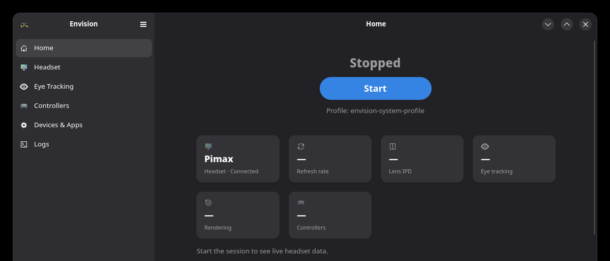

**Forword:**

**Hello! Please go and say a big thank you to everyone who is involded in Monado, Ultradevs Basalt and Envision. Without their groundwork slopviber like me couldnt do things like these. The second their Work is at the same feature list as this the "Fork" will be closed.**

# p3cExtended

Run the **Pimax Crystal Super** VR headset on Linux, natively on Wayland, without proprietary software.

This repository holds patches, scripts and configs on top of:
- [Monado](https://monado.freedesktop.org/) (OpenXR runtime), the community fork with the Rust driver `pimax_p3c`,
- [Basalt](https://gitlab.freedesktop.org/ultradev/basalt) (branch `pose-covariance` + patches) for inside-out head tracking (SLAM),
- [Envision](https://gitlab.com/gabmus/envision) (the VR launcher), patched with Pimax pages,
- small OpenXR test tools (`tools/`).

The upstream sources are not in this repository. The installer clones them at the commits in `sources.lock`.

**Status: experimental.** It works end to end on the developer's setup. Expect rough edges.



## What works
Full list with details: [docs/FEATURES.md](docs/FEATURES.md).

- **Display**: direct mode at 90 Hz (7680x3744), correct stereo (needs the NVIDIA patch below).
- **Head tracking**: inside-out SLAM with Basalt (4 cameras), stable when worn; optional live 1-Euro still smoothing (`PIMAX_HMD_SMOOTHING`).
- **Controllers**: buttons, haptics, optical tracking with 3D + 2D anti-merge protection, separate grip (+34° + lever) and aim (−48.4°) offsets, and live 1-Euro still smoothing (`PIMAX_CTRL_SMOOTHING`).
- **Eye tracking**: gaze through `XR_EXT_eye_gaze_interaction`; in-headset calibration (`pimax-et-calibrate`,
  about 0.44° mean error after calibration); gaze test app.
- **Foveated rendering**: gaze-steered quad views and `XR_VARJO_foveated_rendering` in Monado
  (driver done; testing in games still to do). FOV levels (`PIMAX_FOV_PERCENT`, built, untested).
- **Envision pages**: Home (start/stop, status, summary tiles), Headset (device info, self-test, display, audio, IPD,
  tracking, advanced), Eye Tracking (calibration, gaze and foveation tests, foveation detail), Controllers
  (status, dead zone), Devices & Apps, Logs. Some settings apply live, the rest on the next start.
  Audio switching needs `pactl` (Fedora: pulseaudio-utils, Arch: libpulse, Debian/Ubuntu: pulseaudio-utils), which
  works with PulseAudio and with PipeWire (pipewire-pulse).
- **Headset speakers**: a WirePlumber rule (`config/51-pimax-crystal-audio.conf`) enables `pro-audio` on the Crystal Super (`34a4:0040`, exposing `Pimax Crystal Super DMAS Speakers` on ALSA device 1) and disables UCM on `3654:5678`. Note: the headset's true sound options only appear and play while the XR service (Envision / Monado) is running and the headset is awake.
- Device info: firmware version, serial number and self-test in a status file and in Envision.

Not done: local dimming, controller battery level (brightness and headset restart are built, untested in the headset; see [docs/FEATURES.md](docs/FEATURES.md)). SteamVR support is experimental
(`scripts/steamvr-monado.sh`, eye-tracking component in Monado's SteamVR driver) and not covered here.
OpenVR games can run through xrizer (not installed by the installer).

## Requirements
**Hardware**
- Pimax Crystal Super (P3C10). Other P3C models (Crystal Light, Dream Air) share the driver but are untested here.
- Tracking without lighthouse faceplate (inside-out cameras). The driver turns on SLAM and controller
  tracking automatically when no lighthouse faceplate is found.
- An NVIDIA GPU with the **open** kernel modules (tested on an RTX 40-series card). AMD has a driver
  switch (`PIMAX_GPU=amd`) but is untested.
- The headset needs two display heads of the GPU. If it does not start, unplug other monitors.

**Software**
- Linux with a Wayland session (tested: Fedora 44 based distribution, KDE Plasma 6). No X11 session needed.
- Build tools: CMake, Ninja, a C/C++ compiler, clang (for bindgen), Rust/Cargo, glslang, plus the usual
  Monado/Basalt development packages. `scripts/install.sh --check` lists what is missing.
- WayVR (desktop in the headset; tested with the v26.8.0 release AppImage) at
  `~/.local/opt/wayvr/WayVR-x86_64.AppImage` (or set `PIMAX_WAYVR`). Not installed by the installer.
- Recommended: your distribution's `xr-hardware` udev rules.

### NVIDIA patch (required for stereo)
With 7680x3744 the GPU drives the headset with two display heads ("2Heads1OR"). The NVIDIA open kernel modules
start every head at x=0, so **both eyes show the left eye's image**. `patches/nvidia/` fixes this
(NVIDIA open-gpu-kernel-modules PR #1262, not merged yet). Apply it to the DKMS source and rebuild:
```sh
sudo patch -p1 -d /usr/src/nvidia-<version> < patches/nvidia/0001-nvkms-2heads1or-viewport-origin-PR1262.patch
sudo dkms build --force nvidia/<version> -k <kernel>     # "install --force" alone does not recompile
sudo dkms install --force nvidia/<version> -k <kernel>
# reboot
```
A driver package update replaces the DKMS source: re-apply the patch after every NVIDIA update.

### Kernel patch (optional)
`patches/kernel/` adds the Pimax headsets (EDID `PVR` 0x1019–0x101c) to the kernel's non-desktop quirk list.
The kernel then marks the headset `non-desktop`, so the Wayland compositor leaves it alone and Monado can take
it in direct mode. Use it if your desktop treats the headset as a normal monitor. The same quirk has been
submitted upstream; once a kernel has it, this patch is not needed.

`scripts/install-kernel.sh` only installs an already built, patched kernel tree (modules, `/boot`, DKMS for the
new kernel). It does not patch or build. Pitfalls when building on Fedora-family distributions:
- the quirk is built into `vmlinuz`, so a full kernel build is needed, not a module rebuild;
- `CONFIG_DEBUG_INFO_NONE=y` avoids the pahole/BTF step;
- the distribution config may point `CONFIG_EFI_SBAT_FILE` at a path that does not exist; supply your own file;
- DKMS needs the `build`/`source` symlinks in `/lib/modules/<kernel>/` and rebuilds NVIDIA for the new kernel.
Keep a stock kernel installed to boot back.

## Quick start
```sh
git clone https://github.com/DByte308/p3cExtended.git && cd p3cExtended
scripts/install.sh --check        # list missing build dependencies, change nothing
scripts/install.sh --udev --system
```
`scripts/install.sh [--check] [--no-envision] [--udev] [--system]`. By default it:
- checks the build dependencies,
- clones the pinned sources (`sources.lock`) into `src/` and applies `patches/`,
- builds and installs Basalt, Monado, Envision and the tools into `~/.local`
  (Envision into `~/.local/opt/envision-pimax`),
- copies the headset configs to `~/.config/monado/pimax_p3c`,
- installs `config/51-pimax-crystal-audio.conf` to `~/.config/wireplumber/wireplumber.conf.d/` and
  `config/90-vr-pimax.conf` to `~/.config/environment.d/`.

Options:
- `--check`: only list missing build dependencies.
- `--no-envision`: skip the patched Envision.
- `--udev`: install the udev rules from `config/` (headset HID/USB access, eye tracker), uses sudo.
- `--system`: also copy Monado and Basalt into `/usr`, uses sudo. Needed because Envision's default profile runs
  `/usr/bin/monado-service`, and `run-vr.sh` / `pimax-headset-test` use the client libraries in `/usr`.
  Run it again after every rebuild, or the old copy in `/usr` is used.

Paths can be changed with `PIMAX_SRC` (sources, default `src/`), `PIMAX_PREFIX` (default `~/.local`),
`PIMAX_CACHE` (build trees, logs, test results; default `~/.cache/pimax-linux`) and `PIMAX_WAYVR` (WayVR AppImage).
See `scripts/lib.sh`.

Log out and in again afterwards, so the session gets the variables from `~/.config/environment.d/`
(among them `OXR_PARALLEL_VIEWS=1`, which apps need for correct stereo on the canted panels).

## First start
1. Plug in and power on the headset, switch on the controllers.
2. Start `envision-pimax` (the patched Envision). In Plugins enable **WayVR**, then press **Start**.
3. Put the headset on. You should see the desktop overlay; look around to let tracking settle.

Use Envision **or** `scripts/run-vr.sh [seconds]` (scripted session without Envision), **never both at once**:
each starts its own `monado-service`, and the second one does not get the headset.

## Headset test
`scripts/pimax-headset-test` (headset on, controllers on, follow the spoken prompts; about 45 s). It prints the
view sizes, then records one hold with both controllers pointed straight ahead and checks the controller aim
offset. It uses a running service if there is one. Results stay in `~/.cache/pimax-linux/headset-test/`.

## Configuration
Most settings are on the Envision pages and are saved at once; a banner offers **Restart** when a change needs
a new service start. Envision stores them as environment variables in `~/.config/envision/envision.json`.
Other variables go into Envision's Settings → Advanced. Envision rewrites `envision.json` when it exits, so edit
the file by hand only while Envision is closed.

Main variables (service side):

| Variable | Meaning |
|---|---|
| `PIMAX_REFRESH_HZ` | refresh rate; default 90 for the Crystal Super. **Never 120** (Crystal Light only; other headsets then refuse to power on). 72 untested |
| `XRT_COMPOSITOR_SCALE_PERCENTAGE` | render scale; use 100 (Envision's default 140 is very heavy) |
| `PIMAX_FOV_PERCENT` | FOV level 50–100 |
| `PIMAX_IPD_MM`, `PIMAX_IPD_OFFSET_MM` | lens IPD 58–72 mm (motors, untested); render-only IPD offset |
| `PIMAX_EYE_TRACKING`, `PIMAX_EYE_CALIB` | eye tracking on/off; calibration (written by the calibration tool) |
| `PIMAX_FOVEATION` | gaze-steered quad views (0 = off) |
| `XRT_FOVEATION_INSET_DEG`, `XRT_FOVEATION_INSET_DENSITY_PERCENT`, `XRT_FOVEATION_CONTEXT_PERCENT` | foveation: sharp area size, sharp area resolution, periphery resolution |
| `PIMAX_STICK_DEADZONE` | thumbstick dead zone |
| `PIMAX_AIM_OFFSET_L`, `PIMAX_AIM_OFFSET_R` | override the controller aim offset |
| `PIMAX_GPU` | `amd` for AMD GPUs |
| `XRT_MIRROR_DUMP`, `CONSTELLATION_POSE_LOG`, `SLAM_EUROC_RECORD` | diagnostics, see FEATURES |

Do not use `XRT_COMPOSITOR_DESIRED_MODE` (older Pimax driver only) and never leave `PIMAX_BLANK_EYE` set.
To check which variables a service really got, start it with `XRT_PRINT_OPTIONS=1`.

## Known issues
- **Head tracking can still run away** when the headset faces something closer than about 33 cm (a wall or a
  table), and in a dark room. Partly fixed (patches/basalt 0001); Basalt still does not reset itself, so restart
  the session. See [docs/ROADMAP.md](docs/ROADMAP.md).
- **"Controller lost its rotation"** reports (open, not reproduced with data): in logged sessions both controllers'
  tracked orientation followed every twist. In WayVR a grabbed window keeps facing you, which can look like a
  frozen controller.
- A controller can be lost on very fast shakes.
- A killed `monado-service` leaves `$XDG_RUNTIME_DIR/monado_comp_ipc` behind; the next start fails with
  "Address already in use" until it is removed (`run-vr.sh` does this).
- Envision deletes `~/.config/openxr/1/active_runtime.json` when a session stops; apps started outside Envision
  then find no runtime. `run-vr.sh` and `pimax-headset-test` write it again.
- Envision's "SteamVR Quick Calibration" button is not useful with this headset (no base stations).
- Untested: 72 Hz, lens IPD motors, FOV levels, foveation in games, AMD GPUs.

## Key findings
- **Both eyes show the same image on NVIDIA**: the nvkms 2Heads1OR bug, fixed by `patches/nvidia/`.
- Basalt must be the `pose-covariance` branch (VIT 2.1.0). `main` lacks `vit_pose_get_covariance`, and SLAM then
  fails with "is libbasalt.so installed?".
- Distribution Monado packages do not contain the `pimax_p3c` driver; only the fork in `sources.lock` does.
- Envision's system profile only looks in `/usr` (not `/usr/local`), hence `install.sh --system`.
- The headset streams its IMU at about 1 kHz (~500 reports/s, 2 samples each). Its calibration reports all IMU
  noise values as 0; the driver substitutes non-zero defaults for Basalt.
- The first HMD reports after start-up can be seconds old (USB buffer); the driver drops them so they do not
  break the shared clock (patch 0017).
- `OXR_PARALLEL_VIEWS=1` is read by the **app**, not the service; set it in the session environment.
- `render.force_parallel_projection_on` and `use_tracker` in the headset config files are not read by the driver.

## Repository layout
| Path | Contents |
|---|---|
| `patches/monado/` | Monado fork patches: stereo fixes, eye tracking, foveation, tracking fixes, live settings, diagnostics |
| `patches/envision/` | Envision patches: sidebar shell and Pimax pages |
| `patches/basalt/` | Basalt patches: side cameras keep their keypoints (multi-camera tracking fix) |
| `patches/nvidia/` | NVIDIA open kernel module fix (required for stereo) |
| `patches/kernel/` | optional kernel EDID non-desktop quirk |
| `patches/steamvr-resources/` | experimental SteamVR input profile |
| `scripts/` | installer, session start (`run-vr.sh`), headset test, eye calibration, kernel install |
| `scripts/eyetracking/` | low-level eye tracker tools |
| `config/` | session environment, WirePlumber audio rule, udev rules |
| `tools/` | OpenXR test tools (`xrsizes`, `xrcalib`, `xrfovea`, `xrctrl`, ...) |
| `docs/` | [FEATURES](docs/FEATURES.md), [TRACKING-CHANGES](docs/TRACKING-CHANGES.md), [ROADMAP](docs/ROADMAP.md), [LICENSING](docs/LICENSING.md) |
| `sources.lock` | upstream repositories and pinned commits |

## Licences
Each component keeps its own licence; see [docs/LICENSING.md](docs/LICENSING.md) and `sources.lock`.
In short: Monado BSL-1.0, Basalt BSD-3-Clause, Envision AGPL-3.0 (our patches too), kernel patch GPL-2.0,
NVIDIA patch MIT/GPL-2.0. The `pimax_p3c` driver and the `pimax-protocol` crate have no licence file yet.
No vendor firmware, SDK or proprietary software is included.
